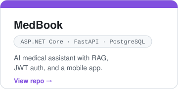
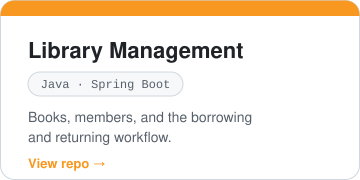
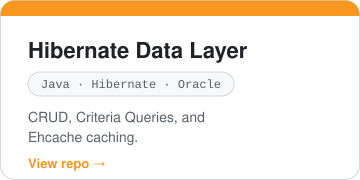
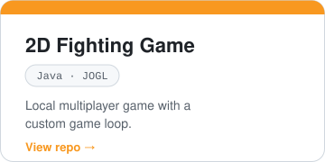
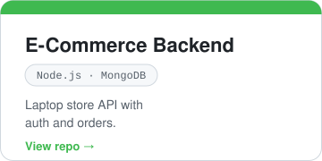
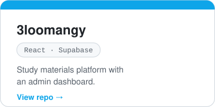
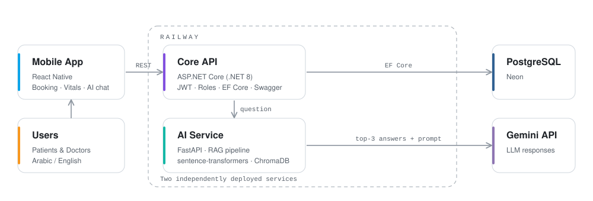

<picture>
  <source media="(prefers-color-scheme: dark)" srcset="./header-dark.svg">
  <source media="(prefers-color-scheme: light)" srcset="./header-light.svg">
  
</picture>

 

Computer Science graduate, Cairo University · Cairo, Egypt

 

<h2 align="center">About</h2>

Java backend developer building REST APIs with Spring Boot and ASP.NET Core, 
from authentication and data access to deployment. 
Led a 5-member team to ship an AI-powered medical platform as my graduation project.

 

<h2 align="center">Tech Stack</h2>

 

<h2 align="center">Projects</h2>

  
  
  
   
  
  
  

 

<h2 align="center">How MedBook Works</h2>

  

 

B.Sc. Computer Science, Cairo University, 2022 – 2026 · BI Development training at ITI · Arabic (native), English (professional)

 

<picture>
  <source media="(prefers-color-scheme: dark)" srcset="./footer-dark.svg">
  <source media="(prefers-color-scheme: light)" srcset="./footer-light.svg">
  
</picture>
